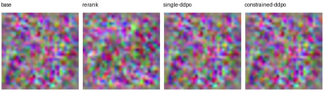

# Diffusion RL reward analysis



The figure is a measured execution check on the small test pipeline. Formal results use the full base and a separate output directory.

This repo reuses the DDPO PyTorch author's stochastic DDIM transition log probability. The local runner rolls out complete trajectories, freezes the old probabilities, computes within-prompt advantages, performs clipped LoRA policy updates and reloads each adapter before evaluation.

```shell
python -m pip install -r requirements.txt
python -m unittest discover -s tests
python run.py demo --device cpu
python run.py reproduce --pickscore /path/to/pickscore --head /path/to/P02/results/head.json
python run.py evaluate
```

The demo uses a tiny test pipeline and a cheap total-variation reward to test the mechanics. Formal evaluation uses the frozen P02 preference scorer on CPU and the SD1.5 policy, plus an additional training arm with a small roughness penalty. Four arms share seeds and candidate count per test prompt. The reranking control selects the highest reward without training. Color-pixel coverage on held-out prompts and pairwise pixel distance are independent diagnostics; they measure narrow image properties. The config separates training and held-out prompts. The final deterministic DDIM step contributes an image but no policy-gradient term.

Run outputs include original sample images, per-step old/new log probabilities and advantages, LoRA update norms, heads' checkpoint hashes, per-prompt diagnostics and the three-metric summary. See `HANDOFF.md` for actual run status.
