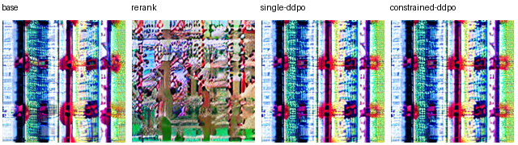

# Diffusion RL reward analysis



Two SD1.5 LoRA policies completed real DDPO training with the frozen head from [Text-to-Image Preference Reranking](https://github.com/zzXavier/text-to-image-reranking) on one RTX 4060 Laptop 8 GB. The table compares three held-out prompts using four equally seeded candidates per prompt for all methods.

| Method | Frozen preference reward | Requested-color pixel fraction | Mean candidate pixel L1 |
|---|---:|---:|---:|
| Frozen base, first candidate | 35.6462 | 0.08674 | 0.36001 |
| Frozen base, select best of four | 36.3719 | 0.12405 | 0.36001 |
| DDPO, single reward | 35.6529 | 0.08807 | 0.36782 |
| DDPO, with roughness penalty | 35.6006 | 0.09011 | 0.36914 |

Best-of-four reranking obtained the highest mean reward and target-color coverage on this small split. The regularized policy had a lower mean reward but higher target-color coverage than the single-reward policy. The first prompt asked for a red bicycle; none of the displayed selections clearly depicts one. Color coverage and pixel diversity therefore cannot certify instruction following. The learned policies also spent 32 training trajectories each, reported separately from their equal evaluation budget. [Per-prompt evidence](results/predictions.json) · [Measured summary](results/summary.csv) · [Policy trace](results/policy-log.json)

A fresh-clone retrain reproduced the two frozen controls exactly. For the two learned policies, the largest changes across runs were 0.021114 in preference reward, 0.002314 in target-color fraction and 0.000972 in pairwise pixel L1. Reranking remained first and both trained arms had higher candidate diversity than the frozen baseline on each run. The sign of single-reward DDPO versus the base reward, and the color-coverage ordering between the two trained policies, changed. This experiment does not support a stable preference improvement or a stable color benefit from the penalty. [Independent retraining results and per-method deltas](results/clean-clone-verification.json).

Each trained arm used 8 epochs, 4 sampled trajectories per epoch, 5 stochastic transitions per trajectory and 2 update passes on each batch, for 16 optimizer updates. The saved trace has 640 finite old/new probability records across the two arms. Both adapter-update norms were nonzero and the restored tensors matched before evaluation. The measured probability ratios stayed within the configured 15% clipping interval; this run does not test how the policies behave under frequent clipping.

This repo reuses the DDPO PyTorch author's stochastic DDIM transition log probability. The local runner rolls out complete trajectories, freezes the old probabilities, computes within-prompt advantages, performs clipped LoRA policy updates and reloads each adapter before evaluation.

```shell
python -m pip install -r requirements.txt
python -m unittest discover -s tests
python run.py demo --device cpu
python run.py reproduce --device cuda
python run.py evaluate
```

The four-coefficient preference head is included in [examples/preference-head.json](examples/preference-head.json). The formal command verifies its SHA-256 and loads the original PickScore encoder from cache or its pinned upstream snapshot. Use --cache to share downloaded weights, and --pickscore for an existing verified checkpoint.

The recorded formal run used --device cuda --reward-device cuda. Use the same flags for a like-for-like run with the pinned SD1.5 snapshot. The demo uses a tiny test pipeline and a cheap total-variation reward to test the mechanics. Formal evaluation uses the frozen preference scorer (CPU by default, or GPU via `--reward-device cuda`) and the SD1.5 policy, plus an additional training arm with a small roughness penalty. Four arms share seeds and candidate count per test prompt. The reranking control selects the highest reward without training. Color-pixel coverage on held-out prompts and pairwise pixel distance are independent diagnostics; they measure narrow image properties. The config separates training and held-out prompts. The final deterministic DDIM step contributes an image but no policy-gradient term.

Run outputs include original sample images, per-step old/new log probabilities and advantages, LoRA update norms, heads' checkpoint hashes, per-prompt diagnostics and the three-metric summary. See `HANDOFF.md` for actual run status.
